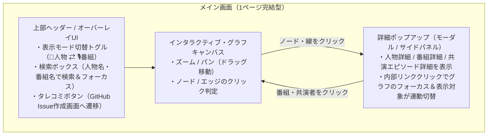
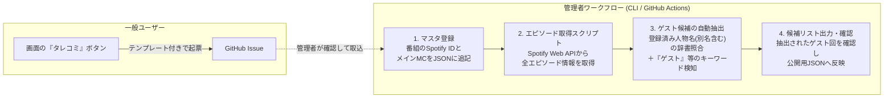

# PodGraph 要件定義書（確定版）

## 1. システム概要
- **システム名**: PodGraph（仮）
- **目的**: ポッドキャスターおよびポッドキャスト番組同士の共演関係をインタラクティブなネットワークグラフ（相関図）として可視化し、リスナーが繋がりから新しい番組やエピソードを発見・再生できるようにする。
- **提供形態**: 1ページ完結型（SPA）Webアプリケーション（PC・スマートフォンのブラウザ対応）
- **インフラ・運用形態**: DBサーバーを持たないGit管理型（静的JSON配信＋GitHub Pages / Vercel / Cloudflare Pages等でホスティング）

---

## 2. 画面構成とUI・インタラクション要件

別ページへの画面遷移は行わず、**単一画面（グラフキャンバス＋オーバーレイUI＋詳細ポップアップ）**ですべて完結する設計とします。



### 2.1 グラフ表示の2モード切替
画面上部のトグルスイッチで、以下の2つのグラフ表現を即座に切り替えられます。

| 項目 | ① 人物モード（デフォルト） | ② 番組モード（トグル切替時） |
| :--- | :--- | :--- |
| **ノード（点）** | **ポッドキャスター（人物）** | **ポッドキャスト（番組）** |
| **ノード画像** | 個人アイコン画像（未設定時は「メイン番組アートワーク」または「イニシャルアイコン」に自動フォールバック） | 番組カバーアートワーク（Spotify APIから自動取得） |
| **ノードサイズ** | 共演相手（繋がっているノード）の数に応じて大きくなる | 繋がっている番組数に応じて大きくなる |
| **エッジ（線）の条件と種類** | **・太い実線**: 同じ番組のメインMC（レギュラー/相方）同士<br/>**・通常の線（または点線）**: ゲスト出演による共演（共演回数に応じて太さが変化） | **・太い実線**: 同じ人物が両番組のメインMCを兼任している<br/>**・通常の線**: 番組AのメインMCが番組Bにゲスト出演した（回数に応じて太さが変化） |

---

### 2.2 ポップアップ（モーダル / ドロワー）の表示仕様
グラフ上のノードまたはエッジをクリック（または検索ボックスから選択）すると、画面遷移せずにポップアップが開きます。
ポップアップ内の番組名やポッドキャスター名をクリックすると、**ポップアップの内容がその対象に切り替わると同時に、背後のグラフも該当ノードへアニメーション移動（フォーカス）**します。

#### A. ポッドキャスター詳細ポップアップ（人物ノードクリック時）
1. **基本プロフィール**
   - アイコン画像、名前、X（旧Twitter）リンク（任意）、一言プロフィール（任意）
2. **メインで出演しているポッドキャスト一覧**
   - 番組アートワーク、番組名（クリックで番組ポップアップへ切替）
   - 外部配信リンクボタン：**Spotify**、**Pocket Casts（任意）**
3. **ゲストとして出演したエピソード一覧**
   - 番組名、エピソードタイトル、配信日、共演したMC・ゲスト名
   - エピソード再生リンクボタン：**Spotify（該当エピソードへ直接遷移）**、**Pocket Casts（任意）**

#### B. 番組詳細ポップアップ（番組ノードまたは番組カードクリック時）
1. **番組基本情報**
   - 番組アートワーク、番組名、番組概要
   - 番組配信リンクボタン：**Spotify**、**Pocket Casts（任意）**
2. **メインMC（レギュラー）一覧**
   - MCのアイコン・名前一覧（クリックでその人物のポップアップへ切替）
3. **ゲスト出演回（共演エピソード）一覧**
   - その番組に他番組のポッドキャスターがゲスト出演したエピソードの一覧（ゲスト名、エピソードタイトル、配信日、Spotify再生リンク等）
   - ※ゲストがいない通常回は保存・表示しない

#### C. 共演詳細ポップアップ（エッジ＝線クリック時）
1. **繋がっている2人（または2番組）の情報**
2. **関係性の内訳**
   - レギュラー共演している番組（ある場合）
   - 2人が共演したゲスト出演エピソードの一覧と各エピソードの **Spotify再生リンク**

---

## 3. データ収集・管理パイプライン（バックエンド / CLI）

DBサーバーを持たず、リポジトリ内のJSONデータとTypeScript製CLIスクリプトで運用します。



### 3.1 半自動データ取込のルール
1. **データソース**: **Spotify Web API** をメインとして使用し、番組情報（タイトル・アートワーク・Spotify URL）およびエピソード情報（タイトル・概要欄・配信日・Spotifyエピソード再生URL）を取得する。
2. **ゲスト出演回の抽出ロジック**:
   - 登録済みポッドキャスターの名前・別名（表記ゆれ・英語表記等）との**辞書マッチング**
   - エピソードタイトル・概要欄に含まれる「ゲスト」「迎えて」「Guest」等の**キーワード抽出**
   - スクリプト実行時に「ゲスト出演回の候補リスト」を出力し、管理者が確認・承認した「ゲスト出演回のみ」を公開用データに保存する。
3. **複数MC番組における共演判定ルール**:
   - 2人以上のメインMCがいる番組にゲストが出演した場合、原則として**「その番組のメインMC全員」と「ゲスト」が共演したものとして自動で線を繋ぐ**。
   - 一部のMCが欠席した特殊な回のみ、エピソードデータ側で出演MCを個別指定（オーバーライド）できるようにする。
4. **ユーザーからのタレコミ機能**:
   - Webアプリ上に「共演情報の追加リクエスト（タレコミ）」ボタンを設置。
   - クリックすると、必要項目（番組名、エピソードURL、ゲスト名など）が入力しやすくなった **GitHub Issue 作成画面（Issue Template）** が開く。

---

## 4. データ構造設計（JSONスキーマ案）

フロントエンドとCLIスクリプトで型定義（TypeScript Interface）を共有するデータ構造です。

```typescript
// 1. ポッドキャスター（人物）
export interface Podcaster {
  id: string;                 // 例: "shibata"
  name: string;               // 表示名
  aliases?: string[];         // 辞書マッチング用の別名・表記ゆれ
  avatarUrl?: string;         // 個人アイコンURL（未設定時はメイン番組画像またはイニシャル）
  bio?: string;               // 一言プロフィール（任意）
  links?: {
    x?: string;               // X (旧Twitter) URL（任意）
  };
}

// 2. ポッドキャスト（番組）
export interface Podcast {
  id: string;                 // 例: "coten-radio"
  title: string;              // 番組名
  imageUrl: string;           // 番組カバーアートURL（Spotify APIより取得）
  hostIds: string[];          // メインMCの Podcaster ID 配列
  links: {
    spotify: string;          // Spotify Show URL
    pocketCasts?: string;     // Pocket Casts URL（任意）
  };
  spotifyShowId?: string;     // API自動取得用のSpotify Show ID
}

// 3. ゲスト共演エピソード（※ゲスト回のみ保存）
export interface GuestEpisode {
  id: string;                 // Spotify Episode ID 等
  podcastId: string;          // どの番組のエピソードか (Podcast.id)
  title: string;              // エピソードタイトル
  publishedAt: string;        // 配信日 (YYYY-MM-DD)
  guestIds: string[];         // ゲスト出演した Podcaster ID 配列
  hostIdsOverride?: string[]; // 通常のメインMCと異なる場合のみ指定（欠席対応等）
  links: {
    spotify: string;          // Spotify Episode 再生URL
    pocketCasts?: string;     // Pocket Casts 再生URL（任意）
  };
}
```

---

## 5. 技術スタック（確定）

- **言語**: TypeScript（フロントエンド・データ取得CLIスクリプト共通）
- **フロントエンド**: React + Vite（または Next.js Static Export）+ Tailwind CSS
- **グラフ描画ライブラリ候補**:
  - `react-force-graph-2d` または `Cytoscape.js`（丸型アイコンノード描画、線の太さ・実線/点線のカスタマイズ、ノードへのズーム・フォーカスアニメーションに強いライブラリ）
- **データ収集スクリプト**: Node.js (`tsx`) + Spotify Web API
- **ホスティング / CI**: GitHub Pages または Vercel / Cloudflare Pages + GitHub Issue Template（タレコミ用）
